# Nadeo Exporter Community Edition

**Nadeo Exporter CE** brings Trackmania (2020) maps and assets into Blender
for **renders**, **cinematics** and **asset work**.

[**Download addon v0.0.13 (ZIP)**](https://github.com/StupsKiesel/nadeo-exporter-ce/releases/download/v0.0.13/nadeo_exporter_ce_0.0.13.zip)
| [Release notes](https://github.com/StupsKiesel/nadeo-exporter-ce/releases/tag/v0.0.13)
| [Changelog](CHANGELOG.md)

Install this ZIP in Blender; see the setup instructions below.

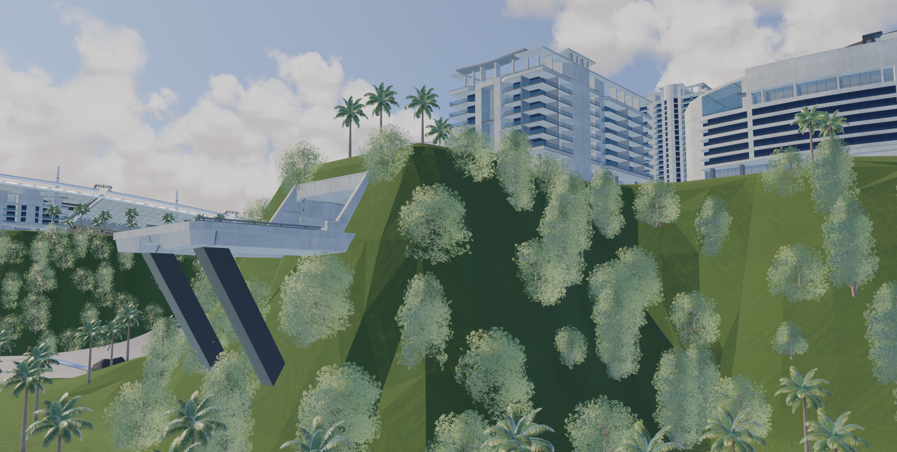

*An imported Trackmania map rendered in Blender.*

> [!NOTE]
> **Version 0.0.13 is a public preview.** Mesh, material and environment
> fidelity is still being refined. Unsupported or unavailable content can
> become placeholders. This is an import and preview tool: **writing GBX
> files and exporting edited maps back to Trackmania are not supported**.

## Contents

- [Features](#features)
- [Requirements](#requirements)
- [Installation and first-run setup](#installation-and-first-run-setup)
- [Openplanet and the GameData library](#openplanet-and-the-gamedata-library)
- [Importing maps and assets](#importing-maps-and-assets)
- [Map import options](#map-import-options)
- [Sidebar tools and MediaTracker](#sidebar-tools-and-mediatracker)
- [Performance and limitations](#performance-and-limitations)
- [Troubleshooting and feedback](#troubleshooting-and-feedback)
- [Credits](#credits)

## Features

### Maps and assets

- Import whole **maps**, including grid blocks, free blocks, anchored items
  and terrain.
- Import individual **items**, **meshes**, **prefabs**, **materials**,
  vegetation trees and editor blocks/clips.
- Select a mesh **LOD**, or import all available LODs with alternatives hidden.
- Inspect map metadata, placements and imported assets in Blender's sidebar.

### Materials and environment

- Recreate supported game materials as Blender node setups.
- Apply stock skins, map signs/skins and texture mods.
- Download referenced custom signs and mods when enabled.
- Adjust texture size to balance detail and memory usage.
- Recreate mood lighting, sky, sun, moon and stars, with optional clouds.
- Include decoration surroundings and authored vista trees/bushes.
- Optionally add terrain grass, stadium grass cards and spectators.

### Game connection and previews

- Use the bundled **Blender Bridge Extractor** Openplanet plugin to fetch
  missing files during map imports from a running Trackmania.
- Alternatively, read from an existing extracted **GameData** library.
- Preview supported MediaTracker camera tracks and edit clips in an
  **experimental MediaTracker editor**.
- Inspect parsed GBX data with the **GBX Inspector**.

## Requirements

- **Blender 3.6.2 or newer**; development testing uses Blender 5.2.3.
- **Windows** for the documented game/Openplanet setup.
- Internet access to install Python dependencies; also needed for optional
  sign/mod downloads.
- For referenced game assets: **Trackmania (2020)** with
  **[Openplanet](https://openplanet.dev/)**, or an existing extracted GameData
  library containing the required files.
- Enough memory and disk space for the maps you intend to import.

## Installation and first-run setup

### 1. Install the packaged addon

> [!IMPORTANT]
> **[Download addon v0.0.13 (ZIP)](https://github.com/StupsKiesel/nadeo-exporter-ce/releases/download/v0.0.13/nadeo_exporter_ce_0.0.13.zip)**,
> then follow the installation steps below.
> Do **not** install GitHub's **Code > Download ZIP** source archive.
> Development packages additionally include a timestamp in their filename.

1. In Blender, open **Edit > Preferences > Add-ons**.
2. Choose **Install from Disk...** from the top-right dropdown in Blender
   4.2 or newer. Earlier versions use the **Install...** button.
3. Select the packaged ZIP and enable **Nadeo Exporter Community Edition**.

The internal addon folder is named `trackmania_blender_bridge`; this is expected.

### 2. Install Python dependencies

1. Expand the addon's preferences.
2. Under **Python Dependencies**, click **Install Dependencies** if packages
   are missing.
3. Save useful work first: downloading/installing dependencies can block
   Blender's interface.
4. Restart Blender when prompted. The dependency status should then be **Ready**.

### 3. Configure paths

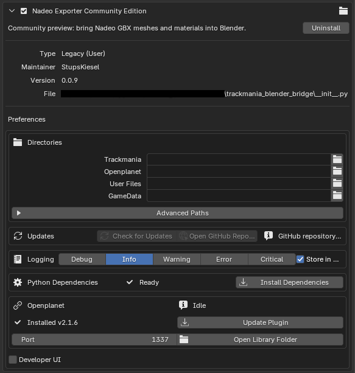

*Empty paths use automatic discovery. Developer UI is not needed for normal use.*

| Directory | Purpose |
|---|---|
| **Trackmania** | Game installation; used to locate packs and stock skins. Standard Ubisoft, Steam and Epic locations are discovered automatically. |
| **Openplanet** | Openplanet's user data folder containing `Plugins` and `Extract`, not its program folder. Defaults to `%USERPROFILE%\OpenplanetNext`. |
| **User Files** | Trackmania user folder containing custom skins; normally `Documents\Trackmania`. |
| **GameData** | Extracted game library read by imports. Defaults to `Extract\GameData` under the Openplanet user folder. |

Under **Advanced Paths**, you can override the game packs folder, enable a
**Parse Cache Directory**, or choose a **Skin Cache Directory**.

### Updating

Install the newer packaged ZIP over the existing addon, then restart Blender.
Preferences and installed dependencies are retained. If the bundled Openplanet
plugin changed, use **Update Plugin** and reload it in Openplanet.

## Openplanet and the GameData library

A map references game assets that are not necessarily embedded in the map.
The GameData library provides those meshes, materials, textures and other files.

### Set up the live bridge

1. Install [Openplanet](https://openplanet.dev/) for Trackmania.
2. In Blender's addon preferences, under **Openplanet**, click **Install Plugin**.
3. Start Trackmania. Press **F3** to open Openplanet and set
   **Developer > Signature mode > Developer** to allow the unsigned plugin.
4. If the game was already running when you installed or updated the plugin,
   reload it through Openplanet's developer menu or restart Trackmania.
5. Import a map with **Fetch Missing Files** enabled.

During an opted-in map import, Blender starts a local bridge on
`127.0.0.1:1337`. Openplanet extracts requested files into
`<Openplanet user folder>\Extract\GameData`. Previously extracted files are
reused where possible.

**Idle** is normal when no import or library task is using the bridge.
During activity, preferences show **Waiting for Trackmania** or
**Connected to Trackmania**. Installing the plugin alone does not keep a
server running.

In the game, the Blender logo at the right end of the Openplanet menu bar
(`F3`) shows the bridge status and extraction progress: green when connected,
blue with a progress line while extracting.

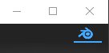

Click it for the plugin panel: switch listening for Blender on or off, follow
the running request or see the last result, and set the port and logging.
Some requests can still fail.

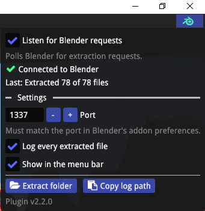

The **Port** slider in addon preferences changes the bridge port. If you
change it, set the same port in the plugin's **Server URL** setting
(default `http://127.0.0.1:1337`).

The bridge communicates locally between Blender and Trackmania. Dependency
installation and optional sign/mod downloads are separate internet operations.

### Choose where to keep extracted files

> [!WARNING]
> The extracted library can grow beyond **10 GB**, depending on your imports.
> Prefer a drive with plenty of free space rather than filling your Windows
> system drive.

For an existing library on another drive, set **GameData** in addon preferences
to that library's root folder, for example `D:\TrackmaniaLibrary\GameData`.
It must contain the GameData contents, such as `Stadium`, rather than an
additional nested GameData folder.

The plugin always extracts to Openplanet's own `Extract\GameData` staging
folder. With a custom library, the addon moves each extracted file from there
into the library, so the files don't stay on the system drive. This covers
import fetches, Check / Repair, Fill Missing and manual requests. Pointing to
an empty folder works: imports fetch what they need, and **Fill Missing** fills
the rest. Keep some free space in the Openplanet staging location for files
on their way to the library.

### Maintain the library

Open the 3D Viewport sidebar with **N**, then
**Nadeo Exporter CE > Tools > Game Library**:

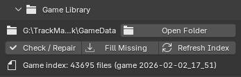

- **Open Folder** opens the configured library.
- **Refresh Index** updates the list of files available in the running game.
  It does not extract the entire game.
- **Check / Repair** checks existing library files and requests normal
  extraction of replacements for detected broken files. Validated replacements
  are moved from Openplanet's staging folder into the configured library.
  Some files may remain unresolved.
- **Fill Missing** compares the library with the game index and extracts the
  files the library doesn't have yet. A dialog shows the file count and size
  first. Audio, video and shader files are skipped unless **Include Audio,
  Video and Shaders** is enabled. Valid files already waiting in the staging
  folder are moved without extracting them again. A full fill can take a long
  time and need many GB.

Check / Repair and Fill Missing retry files that fail. First they request a
normal extraction again. Then GBX files go through hook extraction, one file
at a time. If the hook output lacks header data the game skipped, that data is
restored from the normal extraction. A file is installed only if it has the
game's exact size and passes validation. Hook extraction can crash the game in
rare cases. Files the game reports as not available, such as shader sources it
doesn't ship, are remembered for that game version and skipped by later fills.

These actions start the bridge when needed and run in the background. A
progress line with a **Cancel** button appears under the buttons. Refreshing
the index or extracting files requires Trackmania with the extractor enabled.
Files that fail validation stay in the staging folder.

For offline imports, use a populated library and turn **Fetch Missing Files**
off. Missing assets cannot be recovered without a suitable source.

## Importing maps and assets

### Your first map

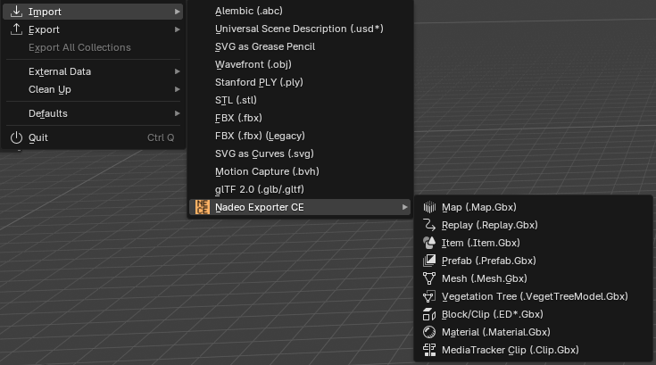

1. Choose **File > Import > Nadeo Exporter CE > Map (.Map.Gbx)**.
2. Select a map, for example from `Documents\Trackmania\Maps`.
3. Start with a small map and the default **Map** mode.
4. Keep Trackmania running if **Fetch Missing Files** is enabled.
5. Import and wait for asset building to finish.

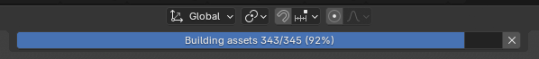

The viewport frames the imported map. Check the **Map** panel's import
statistics and warnings: finishing an import does not mean every asset was
available or fully supported.

### Individual files

The same import submenu includes:

| Entry | Use |
|---|---|
| **Item (.Item.Gbx)** | Custom or stock items, with supported geometry, materials and placement metadata. |
| **Prefab (.Prefab.Gbx)** | Hierarchies of meshes, entities and supported lights. |
| **Mesh (.Mesh.Gbx)** | Individual meshes with materials. |
| **Vegetation Tree (.VegetTreeModel.Gbx)** | Supported tree or bush geometry. |
| **Block/Clip (.ED*.Gbx)** | Editor block definitions and their variants. |
| **Material (.Material.Gbx)** | Blender material/node setup; optionally assign it to the active object. |
| **Replay (.Replay.Gbx)** | Replay import and preview. |
| **MediaTracker Clip (.Clip.Gbx)** | Standalone clip with an approximate camera preview. |

Referenced files must be available in the game library. Most geometry
importers offer **LOD Level**; `1` selects the highest detail where supported.
The map import's experimental hook-extraction option does not apply to the
separate standalone importers or library repair.

## Map import options

**Map** mode uses a preset including surroundings, mood lighting, sky,
clouds, map signs/skins, texture mods and authored vista trees/bushes.
Optional grass and added spectators are off; mesh LOD is `1`.

**Custom** mode exposes individual content controls. Switching modes does
not overwrite your Custom choices. Fetching files, texture size and sign/mod
downloads remain separate controls in both modes.

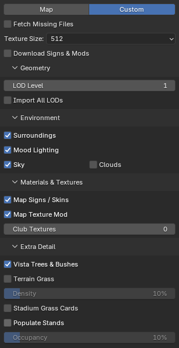

*This screenshot illustrates Custom mode with experimental hook extraction
enabled under its former "Experimental Hooked Tree Extraction" label. The
option is now called "Experimental Hooked Extraction" and covers tree models
and item files. It is **off by default** and is not recommended for routine imports.*

| Option | Effect |
|---|---|
| **Fetch Missing Files** | Allows live Openplanet requests for missing or broken game files. On by default. |
| **Experimental Hooked Extraction** | Allows one hook retry per failed `VegetTreeModel` or `Item.Gbx` file during a map import. Off by default; requires Fetch Missing Files. |
| **Texture Size** | Maximum texture resolution, from `128` to `2048`, or `Original`. Default `512`. |
| **Download Signs & Mods** | Allows downloads from the URLs referenced by the map. |
| **LOD Level / Import All LODs** | Choose mesh detail, or retain other available LODs as hidden alternatives. |
| **Surroundings** | Include decoration scenery such as stadium stands, ocean and hills. |
| **Mood Lighting / Sky / Clouds** | Recreate supported environment lighting and sky effects. Clouds require Mood Lighting and Sky. |
| **Map Signs / Skins / Map Texture Mod** | Apply the map's skins and texture replacements. |
| **Club Textures** | Club ID for public screen textures; `0` disables these downloads. |
| **Vista Trees & Bushes** | Include authored vegetation in the surroundings. |
| **Terrain Grass / Density** | Add terrain grass billboards at the selected density. |
| **Stadium Grass Cards** | Add grass cards around stadium grass areas; can be expensive. |
| **Populate Stands / Occupancy** | Add spectators at the selected occupancy. |

> [!WARNING]
> **Hook extraction is experimental and may crash Trackmania.** It is limited
> to tree-model and item-file fallback requests, does not recover files reported as
> `NOTFOUND`, and does not guarantee a complete or parseable result. A failed
> hook attempt restores the previous file when one was available.

## Sidebar tools and MediaTracker

Press **N** in the 3D Viewport and select **Nadeo Exporter CE**.

### Map

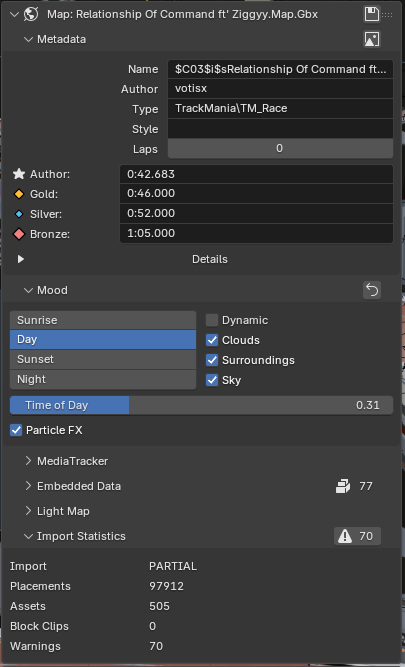

- **Metadata:** map name, author, medal times and other source information.
- **Mood:** adjust mood, time of day and supported sky/environment controls.
- **MediaTracker:** access available map clip slots.
- **Embedded Data / Light Map:** inspect available map-owned data.
- **Import Statistics:** review status, placements, assets and warnings.

*The example shows a partial import with warnings, not a fidelity guarantee.*

### Active

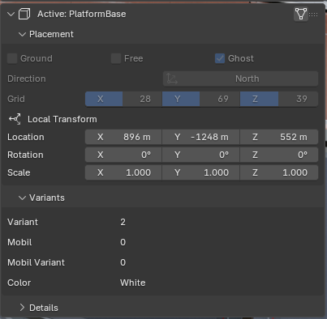

Selecting an imported object shows available placement, transform, variant
and source details. Many map placements share reusable asset collections
rather than separate mesh copies.

### Tools

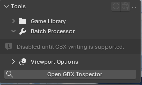

**Game Library** provides the maintenance actions described above.
**Viewport Options** provides viewport controls, and **Open GBX Inspector**
opens a parsed-data browser.

**Check for Updates** checks GitHub for a newer published release; it also
runs once automatically a few seconds after Blender starts. When an update is
found, the button becomes **Install vX.Y.Z (Release)** or
**Install vX.Y.Z (Pre-release)**. It shows a confirmation, then downloads the
addon ZIP from the GitHub release and installs it in place while keeping your
settings. Restart Blender afterwards to finish the update. Pre-releases
(previews) are offered too; turn off **Include Pre-releases** in the addon
preferences to get full releases only. **Open GitHub Repository** opens the project page, or the
release notes when an update is shown.

**Batch Processor is disabled until GBX writing is supported.**
Developer UI is optional and intended for debugging, not first-run setup.

GBX Inspector example

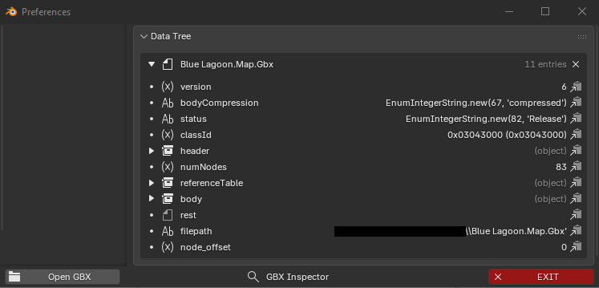

The inspector displays parsed source data; it is not a GBX export editor.

### Experimental MediaTracker editor

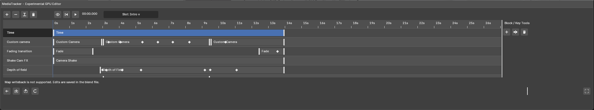

Open available clips through the Map panel's **MediaTracker** section.
For an imported standalone clip, right-click its Empty in the Outliner and
choose **Edit MediaTracker**.

The editor shows supported tracks and keyframes for inspection and editing.
Camera previews approximate the game; unsupported tracks or effects may not
reproduce their in-game behavior. **Edits are saved in the blend file, not
written back to the original map or GBX file.**

### Image/UV Editor: experimental trimsheets

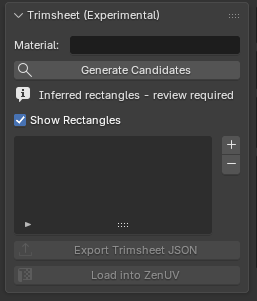

In the **Image/UV Editor**, press **N** and open **Trimsheet (Experimental)**.
Enter a material name or an absolute `.Material.Gbx` path, then choose
**Generate Candidates**. Review and adjust the inferred rectangles; they are
not authored GBX trim definitions.

Use **Show Rectangles** to display the image overlay, **Export Trimsheet JSON**
to save reviewed regions, or **Load into ZenUV** when ZenUV is enabled.
This experimental tool does not automatically assign UVs, modify materials,
or write GBX files.

## Performance and limitations

### Keep imports manageable

- Start with a small map before importing a large scene.
- Lower **Texture Size** and select a simpler LOD in Custom mode for previews.
- Leave **Import All LODs**, optional grass and spectators off unless needed.
- Enable a **Parse Cache Directory** under Advanced Paths for repeated imports.
  Source changes invalidate cached entries; leaving the setting empty disables it.
- Keep sufficient RAM available. Shared assets reduce duplication, but large
  maps, high-resolution textures and optional scenery can still consume
  substantial memory.
- Keep the game library between imports to avoid repeatedly extracting assets.

### Current limitations

- Missing or unsupported assets can become placeholders.
- Some game files extract incompletely, even when Openplanet is connected.
- Materials, sky, lighting and MediaTracker previews are approximations.
- Mesh Modeler items with deform layers may differ from their in-game appearance.
- No GBX writing or edited-map export is supported; the Batch Processor is disabled.
- A successful import or render is not proof of exact in-game fidelity.

## Troubleshooting and feedback

| Symptom | What to check |
|---|---|
| Missing Python dependencies | Run **Install Dependencies**, then restart Blender when prompted. |
| Openplanet shows **Idle** | Expected outside an import/library task. Start an opted-in map import or Refresh Index to use the bridge. |
| **Waiting for Trackmania** persists | Check that the game is running, the plugin is enabled/reloaded, signature mode is Developer, and both sides use the same port. |
| Bridge port already in use | Check for another Blender/bridge instance using that port. Closed connections can be reused between imports on Linux; an active listener must still be stopped or moved to another port. |
| Missing assets or placeholders | Check the configured GameData folder, import warnings and extraction results. Re-importing can retry available files. |
| `NOTFOUND` extraction result | The requested path was not found in the running game's file system. This is not proof of a dead reference; hook mode does not fix a missing path. |
| `SIZE` or incomplete extraction | Check Openplanet's log. Check / Repair retries normal extraction; the map's opt-in tree/item hook fallback is experimental and risky. |
| Skins or signs are missing | Check Trackmania/User Files paths, map skin options, and whether downloads are allowed. |
| Imports use too much memory or take too long | Lower texture size/detail and disable optional grass, spectators and extra LODs. |

A batch can extract some files successfully while others fail. An orange
warning icon next to the Blender logo in the Openplanet menu bar briefly marks
failed files; its panel shows the first failure. Read the individual results rather
than treating the whole batch as successful.
Openplanet's current log is normally `%USERPROFILE%\OpenplanetNext\Openplanet.log`.

### Logs and bug reports

Enable **Store in Blend** in the preferences' Logging row before reproducing
an issue. Each import creates an internal Text log readable in Blender's
**Text Editor**. Save the blend file to retain it; the option does not create
external log files.

Include:

- Blender and addon versions.
- The map/asset type and import options.
- Expected versus actual behavior, with a screenshot when useful.
- Relevant import warnings and Openplanet extraction results.

**Review logs before sharing them:** they can include full local paths.
Report issues through the project's GitHub **Issues** page.

Find community maps on **[Trackmania Exchange](https://trackmania.exchange/)**
and items on **[Item Exchange](https://item.exchange/)**.

## Credits

- Maintained by **[StupsKiesel](https://github.com/StupsKiesel)**.
- **NICE / [gbx-py](https://github.com/schadocalex/gbx-py)**: community GBX parser
  originally created by **[schadocalex](https://github.com/schadocalex)**.
  The bundled NICE version is substantially extended and modified.
- **[Openplanet](https://openplanet.dev/)**: plugin platform used by the bundled
  Blender Bridge Extractor to retrieve files from the running game.
- **[GBX.NET](https://github.com/BigBang1112/gbx-net)** by
  **[BigBang1112](https://github.com/BigBang1112)** and contributors:
  a reference for GBX format definitions used in parser development.

Trackmania and its game content belong to their respective rights holders.
**Nadeo Exporter CE is an unofficial community project**, not an official
Nadeo or Ubisoft product. Supporting game formats does not imply affiliation
with Nadeo, Ubisoft or the projects credited above.
